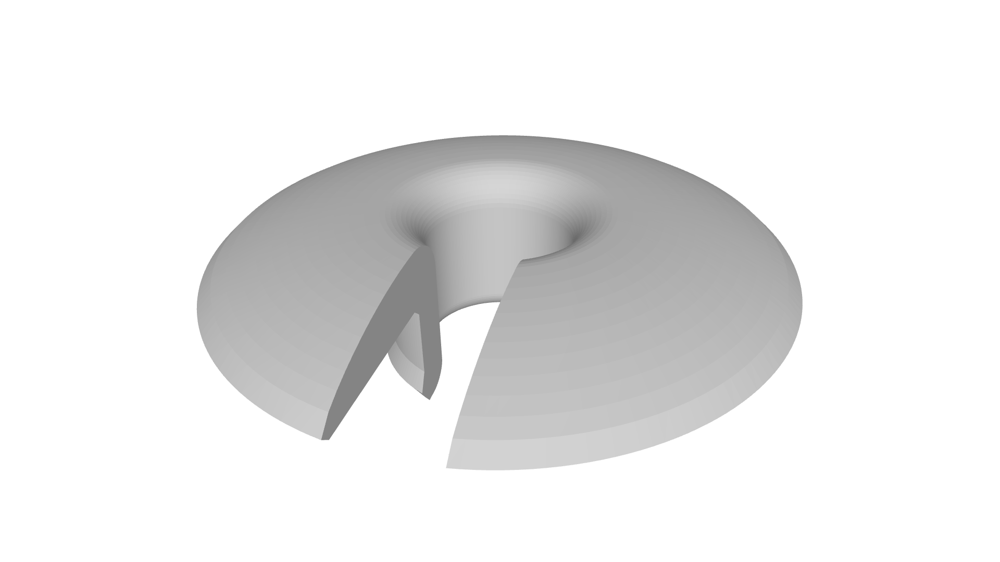
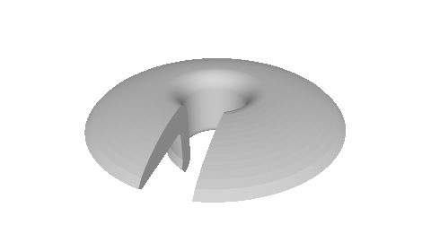
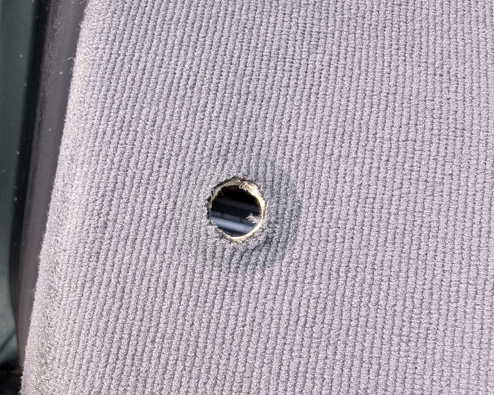
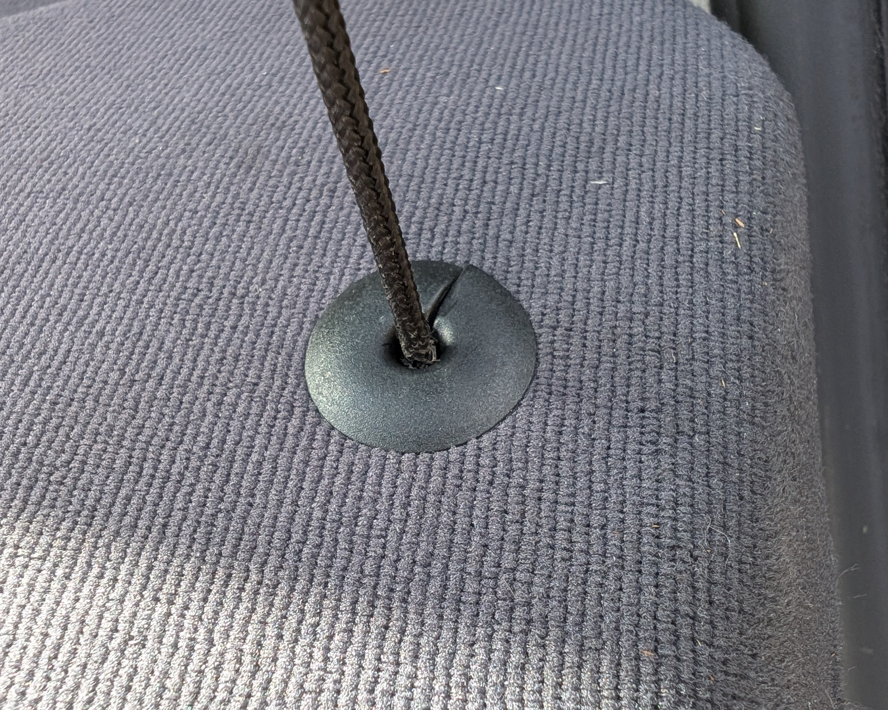
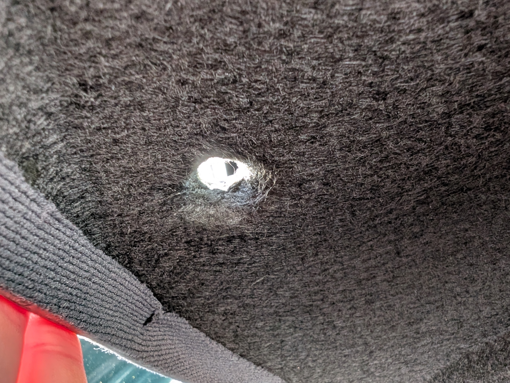
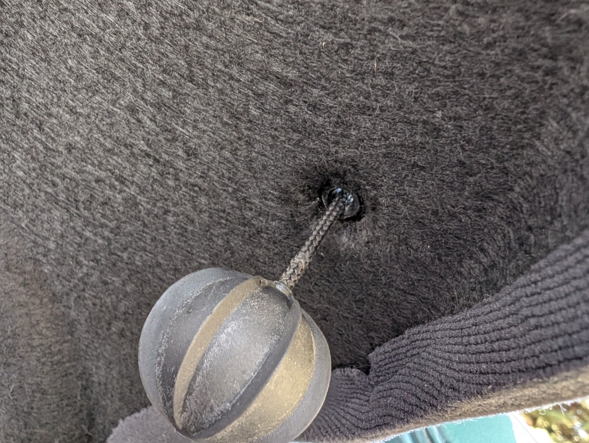

# Replacement Parcel Shelf Cord Grommet / Guide Bushing for Audi A3 8P

  
  

This repository contains a 3D-printable replacement guide bushing (grommet) for the parcel shelf hanging cord on an Audi A3 8P (modeled for my 2003 1.6L 102 HP 3-door hatchback, HSN/TSN: 0588/828), created with the help of Gemini.

> [!IMPORTANT]
> I have just ordered the printed parts and don't have photos of the installed print yet. As soon as they arrive, I will update this README with real-life pictures!

---

**Available in other languages:**

[English](README.md) | [Deutsch](README.de.md)

---

## Background

On one side of my Audi A3's parcel shelf, the entire hanging mechanism was missing: the cord with the rubber ball weight, the clip underneath, and the little plastic bushing that guides the cord through the board. While the cord and the clip are easy to find and buy online, that tiny round plastic grommet is practically impossible to buy on its own.

I tried finding a suitable off-the-shelf part online, but nothing really matched the original look and dimensions at a reasonable single-piece price (rubber grommets create too much friction for the cord to slide back down, and matching nylon flange bushings were only sold in overpriced packs of 12). Going to a scrapyard would have been an option, but way too time-consuming for such a tiny piece of plastic. So I experimented a bit and had Gemini model a custom replacement part ready for 3D printing.

## The Problem vs. Original Part

### Top View (left: missing, right: original)

  
  

### Bottom View (left: missing, right: original)

  
  

## 3D Model Details

### Included Files (`stl/` folder)

There are three slightly different versions included (along with the parametric OpenSCAD source file in `cad/`):

1. **`audi_a3_8p_grommet_snap_lip.stl` *(Recommended)*:** Original domed top shape with a subtle 8.6 mm snap lip at the bottom of the shaft so it clicks securely into place underneath the parcel shelf.
2. **`audi_a3_8p_grommet_smooth.stl`:** Same domed top, but with a completely smooth 8.0 mm shaft (useful if your hole is a very tight fit or if you prefer gluing it in).
3. **`audi_a3_8p_grommet_print_optimized.stl`:** Optimized for home FDM printers. It features a flat chamfered top and is pre-oriented upside down to print cleanly without any supports.

### Specifications

- **Outer shaft diameter:** 8.0 mm (fits the factory hole)
- **Inner bore:** 5.2 mm with flared entry/exit (smooth sliding for the 4.0 mm cord)
- **Top flange:** 20.0 mm diameter
- **Insertion slot:** 3.2 mm (allows squeezing the 4 mm fabric cord in sideways without cutting the cord or ball weight)

### Print Recommendations

- **Process:** SLS or FDM
- **Material** (from best to least optimal): Nylon (PA12 / PA6), ASA, ABS, or PETG
- **Infill:** 100%
- **Layer height** (for FDM): 0.12 – 0.16 mm (for smooth sliding surfaces)

> [!WARNING]
> **Please avoid PLA**, as cabin temperatures directly underneath the rear window in summer will easily soften and deform the part.

**Installation Tip:** Orient the grommet so the slot faces away from the tailgate (pointing toward the rear seats). That way, when the tailgate pulls the cord, it always slides against the smooth, solid inner wall.

### Real-Life Result (IRL)

*Coming soon once the printed parts arrive...*